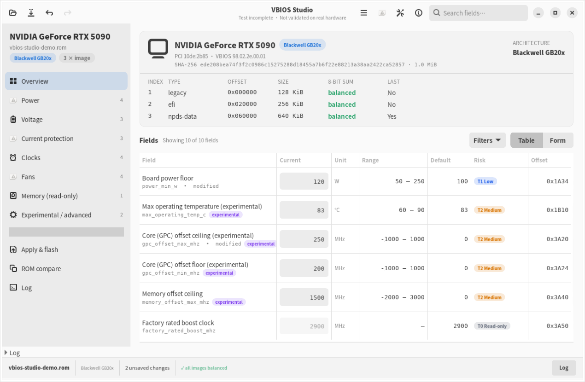
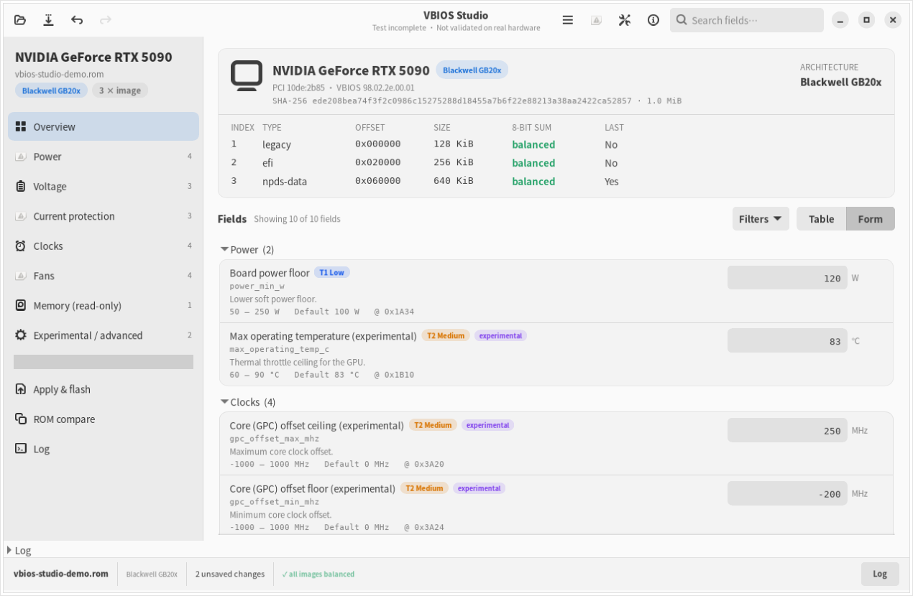
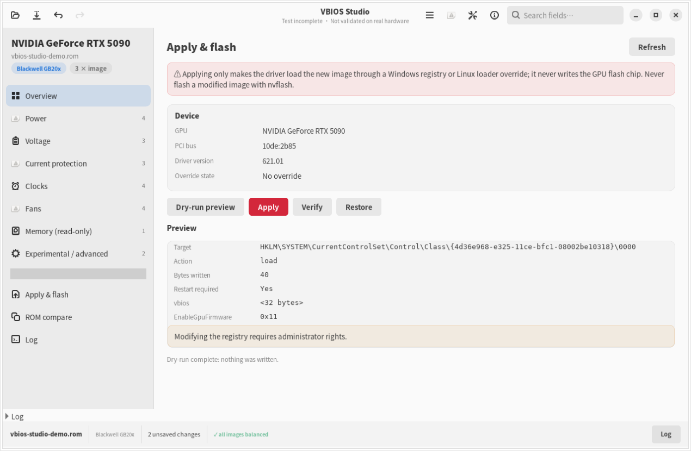

# VBIOS Studio

> [!WARNING]
> ## ⚠️ 测试不完全 / 未在真实硬件验证
>
> **本项目尚未在真实 GPU 上完成验证。** 我们没有在真实硬件上执行过编辑后的应用、Windows 注册表 override、Linux loader 注入或任何刷写操作；自动化测试只覆盖离线解析、合成 ROM、fake 注册表/命令 runner、dry-run 与 xvfb 离屏 UI。
>
> - 上游项目的历史用户报告**不代表本项目已验证**；不同厂商、型号、散热与供电设计的结果可能完全不同。
> - 修改 VBIOS 可能导致死机、花屏、过热、硬件永久损坏或失去保修。
> - **修改后的镜像签名失效，严禁使用 nvflash 刷写。** 修改后镜像只能通过 Windows 注册表 override 或 Linux loader 应用。
> - 刷写通道只接受**原厂未修改镜像**，且必须逐项校验；本项目默认禁用刷写。
> - 使用风险完全由你自行承担。详见 [`docs/risk-model.md`](docs/risk-model.md)、[`docs/security.md`](docs/security.md) 与 [`docs/testing.md`](docs/testing.md)。

VBIOS Studio 是基于 [Panchovix/nvidia-vbios-vix-editor](https://github.com/Panchovix/nvidia-vbios-vix-editor) 与 [nvidia-windows-vbios-vix-loader](https://github.com/Panchovix/nvidia-windows-vbios-vix-loader) 构建的 GTK4 图形化 NVIDIA VBIOS 编辑 / 应用套件：离线打开与检查 ROM，按 T0–T3 风险分级编辑字段（含实验性字段），生成新的 VBIOS 与 loader payload，并通过受控的 loader override 让修改生效。中英双语，Windows / Linux 双平台。

> **项目状态**：v0.1.0 预发布（代码与文档已完成，等待独立评审与发布）。当前源码树中 GUI 的 diff / profile 视图与生产控制器接线（`app/container.py` 的 `build_gui_controller()`、`adapters/diff.py`、`adapters/profile.py`）已落地，并由 `tests/integration/test_real_controller.py` 覆盖真实路径；但尚未在真实 GPU 上验证。
>
> 非 NVIDIA 官方项目，未获 NVIDIA 认可或赞助。NVIDIA、GeForce 是 NVIDIA Corporation 的商标。

## 目录

- [截图](#截图)
- [功能一览](#功能一览)
- [风险分级（T0–T3）](#风险分级t0t3)
- [安全边界（必读）](#安全边界必读)
- [支持矩阵](#支持矩阵)
- [安装](#安装)
- [快速开始](#快速开始)
- [上游关系与 GPL 继承](#上游关系与-gpl-继承)
- [测试与已知限制](#测试与已知限制)
- [文档](#文档)
- [开发与质量闸门](#开发与质量闸门)
- [许可证与免责声明](#许可证与免责声明)

## 截图

截图由 xvfb 离屏运行的 `python -m vbios_studio.ui --selftest --screenshots docs-assets/screenshots` 生成，展示的是真实界面，不是手绘 mockup：

| 主窗口 | 字段与风险徽章 | 应用 / 刷写面板 |
| --- | --- | --- |
|  |  |  |

## 功能一览

对应需求 [`docs/requirements.md`](docs/requirements.md) §4 的 GUI-01–GUI-10：

1. **顶部工具栏**：打开 / 另存为 / 撤销 / 重做 / 搜索 / 语言 / 主题 / 帮助，全部带快捷键与提示。
2. **左侧导航 + 文件信息卡片**：产品名、PCI ID、BIOS 版本，以及镜像链列表（序号 / 类型 / 大小 / 8-bit 校验和是否平衡）。
3. **表格视图 ↔ 表单视图**：表格固定列为字段、当前值、单位、范围、默认值、风险徽章、原始偏移，可按列排序。
4. **搜索与过滤**：三个独立开关（仅已修改 / 仅实验性 T3 / 仅当前分区）+ 实时命中计数。
5. **撤销 / 重做**：≥20 步，`Ctrl+Z` / `Ctrl+Y` / `Ctrl+Shift+Z`；新开 ROM 清空栈。
6. **预设 profile**：一组改动存为 JSON，可套用到另一份 ROM；架构不符整体拒绝且零部分写入。
7. **双 ROM 差异视图**：字段级（相同/不同/仅左/仅右）+ 镜像级（序号、类型、大小、校验和、差异计数）。
8. **应用 / 刷写面板**：设备状态卡片、dry-run 预览、执行与还原，所有写操作二次确认。
9. **空状态与错误体验**：拖放引导、统一可复制的错误对话框、帮助菜单快捷键表、About 中的测试声明。
10. **无障碍**：全部控件可 Tab 遍历、有 accessible label；风险配色统一 T0 灰 / T1 蓝 / T2 橙 / T3 红，且颜色不是唯一信息载体。

## 风险分级（T0–T3）

| 等级 | 含义 | 默认 UI | 门槛 |
| --- | --- | --- | --- |
| **T0** | 只读 / 信息：解析、展示、校验、差异、语言主题 | 可见 | 无；只读字段不可编辑 |
| **T1** | 低风险：只降低电气/热包络或增加散热余量，重启可恢复 | 可见 | 普通确认 |
| **T2** | 中风险：功耗/时钟/风扇策略调整，可能死机或过热降频 | 可见（实验字段带徽章） | 应用前确认 + 变更预览 |
| **T3** | 高风险 / 实验性：电压、电流/OCP、保护阈值、高级电源行为 | **默认隐藏** | 解锁实验模式 + 逐字段二次确认 + 应用总确认 |

完整字段归属、方向规则与证据说明见 [`docs/risk-model.md`](docs/risk-model.md)。实验性字段不等于“可随意修改”：T3 字段在解锁前不可见、不可写。

## 安全边界（必读）

1. **修改后的镜像签名失效，禁止 nvflash 刷写。** 编辑不会重新签名；nvflash 会拒绝，或造成不可恢复的损坏。
2. **刷写通道只接受原厂未修改镜像**，且必须逐项通过：SHA-256 与原始记录一致、逐字节相同、每张镜像校验和平衡、结构有效、PCI/子系统 ID 匹配、nvflash 版本受支持、管理员权限、显式确认。任何一项失败即拒绝，且不启动 nvflash。
3. **主路径是 loader override**：
   - Windows：写驱动注册表 `vbios` / `EnableGpuFirmware` / `VixLoaderPreviousEnableGpuFirmware`，`pnputil /restart-device` 重启设备；不写 flash 芯片。
   - Linux：生成 payload 与指引，由 `nvidia-linux-vbios-vix-loader` 启动时注入；本项目不自动提权。
4. **原文件只读**：所有保存都写入新文件，另附 `.json` manifest；原文件 SHA-256 全程校验。
5. **默认禁止刷写**：即使原厂镜像也需要显式打开开关、`--i-understand-flash-risk` 与二次确认。

## 支持矩阵

| 架构家族 | 检查 | 编辑 | 应用（override） | 刷写（仅原厂） | 验证状态 |
| --- | --- | --- | --- | --- | --- |
| Blackwell GB20x（GB202/203/205/206） | ✅ | ✅ 按上游审核字段 | ✅ | 默认关闭 | 上游有用户报告；**本项目未在真实硬件验证** |
| Ada AD10x | ✅ | ✅ 部分字段实验性 | ✅ `ada-relocated-v2` | 默认关闭 | 上游少量型号；**本项目未验证** |
| Ampere GA10x（GA102–GA107） | ✅ | ⚠️ 全部字段上游标注实验性 | ✅ `ampere-relocated-v1` | 默认关闭 | 上游少量型号；**本项目未验证** |
| Turing TU10x/TU11x | ✅ | ⚠️ 实验性 | ✅ 需 `turing-e0-end-v1` 兜底 | 默认关闭 | 上游少量报告；**本项目未验证** |
| GA100（A100/A30/A800） | 只读结构报告 | ❌ | ❌ | ❌ | 明确不支持 |
| 未识别 / 损坏镜像 | 只读结构报告 | ❌ | ❌ | ❌ | 降级，不崩溃 |

## 安装

**Windows 10/11 x86_64**

1. 从 Releases 下载 `vbios-studio-<ver>-windows-x86_64.exe` 与 `SHA256SUMS`。
2. 在 PowerShell 中校验：`Get-FileHash .\vbios-studio-<ver>-windows-x86_64.exe`，与 `SHA256SUMS` 对照。
3. 双击启动。exe 由 CI 在 `windows-latest` 上用 Nuitka onefile 构建，自带 GTK4 运行时、首次启动不联网；写注册表的操作需要管理员权限。

**Linux x86_64（glibc ≥ 2.39，GTK 4.14+）**

```bash
tar xf vbios-studio-<ver>-linux-x86_64.tar.gz
cd vbios-studio-<ver>
./bin/vbios-studio --version
xvfb-run -a ./bin/vbios-studio --selftest   # 无非图形环境时可跳过
./bin/vbios-studio                         # CLI
./bin/vbios-studio-gui                     # GUI
```

系统依赖（Ubuntu/Debian）：`sudo apt install python3-gi gir1.2-gtk-4.0 gir1.2-adw-1 libgtk-4-1`。Linux 包使用发行版的 PyGObject，不捆绑 GTK。

**从源码运行**（Python ≥ 3.11）：

```bash
python -m venv --system-site-packages .venv   # PyGObject 走系统包
. .venv/bin/activate
pip install -e .
python -m vbios_studio --version
python -m vbios_studio --selftest
```

## 快速开始

1. 从自有显卡导出原厂 VBIOS（Windows 可用 GPU-Z 保存；Linux 可 `nvflash --save card.rom`，**只读**）。
2. 打开 VBIOS Studio：`vbios-studio --gui card.rom`，或启动后拖入 `.rom` 文件/`Ctrl+O`。
3. 检查文件信息卡片与镜像链：每张镜像的 8-bit 校验和应显示 balanced。
4. 在左侧选择分区，按 T0–T3 徽章编辑字段；T3 字段需先在“设置 → 实验性功能”完成风险确认。示例：调整一个 T2 功率字段，观察“已修改”标记。
5. `另存为…`（`Ctrl+Shift+S`）生成新 ROM + `.json` manifest；原文件保持不动。
6. 打开“应用”面板，选择目标 GPU，先 `dry-run` 预览将写入的注册表键/字节数，再确认执行；`Verify` 检查驱动是否实际加载；`还原` 恢复原状态。
7. 若驱动拒绝 override，显卡会运行原厂 VBIOS；不要反复尝试，先 `unload` 并检查驱动版本。

命令行示例：

```bash
python -m vbios_studio --version
python -m vbios_studio --selftest
python -m vbios_studio --gui path/to/card.rom
```

## 上游关系与 GPL 继承

- 上游 A：[`Panchovix/nvidia-vbios-vix-editor`](https://github.com/Panchovix/nvidia-vbios-vix-editor) @ `1f8ee665bd175bd9ede367e6d15308f837bd987b`（v0.1.28，vendored 到 `src/nvidia_vbios/`）
- 上游 B：[`Panchovix/nvidia-windows-vbios-vix-loader`](https://github.com/Panchovix/nvidia-windows-vbios-vix-loader) @ `ec7bdfe317d3a52de160d17d2bb80ff20813596e`（v0.3.1-6，协议参考）
- 外部 Linux loader：[`Panchovix/nvidia-linux-vbios-vix-loader`](https://github.com/Panchovix/nvidia-linux-vbios-vix-loader)（运行时可选依赖，不捆绑）

本项目以 **GPL-3.0-or-later** 发布，保留上游版权与许可证声明；完整 pin、只读校验与同步流程见 [`UPSTREAM.md`](UPSTREAM.md) 与 [`docs/upstream-sync.md`](docs/upstream-sync.md)。上游作者不对本项目的修改或分发负责。

## 测试与已知限制

**本机最近一次全量测试（2026-10-23，文档整理时点）**：`python -m pytest -q` → **189 passed, 1 skipped**（1 项跳过是 `.gitignore` 由仓库整理阶段交付；发布前会重跑并更新）。静态闸门：`ruff check`、`ruff format --check`、`mypy --strict src/vbios_studio`、`lint-imports`、`python -m vbios_studio --version` 均通过。测试明细与盲区见 [`docs/testing.md`](docs/testing.md)。

**未测试 / 无法测试（发布时必须保留）**：

- ❌ 真实 GPU 上的编辑应用、override、压力测试、长期稳定性。
- ❌ Windows 实机注册表写入、驱动重启、Verify 全流程；Windows 构建仅由 CI 静态配置与 `windows-latest` job 覆盖，本地未实测。
- ❌ 各厂商/机型/散热/供电设计的兼容性差异。
- ❌ Linux loader 的实际注入（外部项目）。
- ❌ 任何刷写操作（本项目默认禁用，且不做真机刷写验证）。
- ❌ 未来 NVIDIA 驱动是否仍支持 override。

## 文档

| 文档 | 内容 |
| --- | --- |
| [`docs/requirements.md`](docs/requirements.md) | 需求契约（6 组功能 + GUI M1 基线 + Ports 附录） |
| [`docs/risk-model.md`](docs/risk-model.md) | T0–T3 风险模型、字段归属、nvflash 安全边界 |
| [`docs/architecture.md`](docs/architecture.md) | 分层架构、依赖图、import-linter 契约、数据流 |
| [`docs/file-tree.md`](docs/file-tree.md) | 目录/模块职责（逐模块） |
| [`docs/testing.md`](docs/testing.md) | 测试矩阵、命令、证据与已知盲区 |
| [`docs/upstream-sync.md`](docs/upstream-sync.md) | 上游同步手册与冲突处理 |
| [`docs/i18n.md`](docs/i18n.md) | gettext 翻译流程 |
| [`docs/security.md`](docs/security.md) | 安全模型、数据与权限边界 |
| [`docs/faq.md`](docs/faq.md) | 常见问题与故障排查 |
| [`UPSTREAM.md`](UPSTREAM.md) | 上游 URL、pin SHA、同步日志 |

## 开发与质量闸门

```bash
python -m venv --system-site-packages .venv
. .venv/bin/activate
pip install -r tools/requirements-dev.txt
pip install -e .
ruff check src tests
ruff format --check src tests
mypy --strict src/vbios_studio
lint-imports
python -m pytest -q
python -m vbios_studio --version
```

一键本地等价检查（与 CI 相同）：

```bash
bash tools/build_local.sh --check
```

CI 使用 Ubuntu 24.04 的系统 PyGObject/GTK4 与 `xvfb`；Windows 构建在 `windows-latest` 的 MSYS2 UCRT64 环境完成。仓库卫生审计与发布前扫描由后续发布流程执行。

## 许可证与免责声明

本项目采用 **GPL-3.0-or-later**。发布仓库根提供 `LICENSE`、`NOTICE.md` 与上游第三方声明；任何再分发必须保留这些文件与上游版权信息。

> **免责声明**：本软件按“现状”提供，不附带任何明示或暗示担保。VBIOS 修改、override、刷写及由此产生的任何硬件损坏、数据丢失、保修失效或其他后果，全部由使用者自行承担。作者与贡献者不对任何直接或间接损失负责。若不同意，请勿使用本软件。
