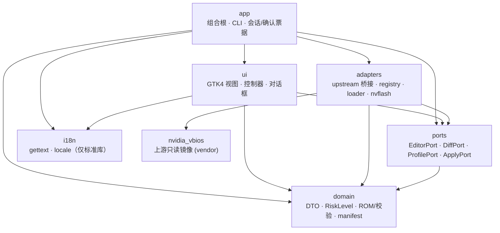

# 架构与分层契约

| 项目 | 值 |
| --- | --- |
| 版本 | `0.1.1` |
| 状态 | v0.1.1 补丁版本（在 v0.1.0 实现基础上完成文档清理与 selftest 临时目录修复） |
| 关联 | [`requirements.md`](requirements.md)、[`risk-model.md`](risk-model.md)、[`file-tree.md`](file-tree.md)、[`../UPSTREAM.md`](../UPSTREAM.md) |
| 强制方式 | `lint-imports` + `tests/contract/` 的 AST/包结构/文档一致性测试 |

## 1. 设计目标

1. **UI 不碰系统**：GTK 视图只渲染 DTO 并调用 `ports`；文件、注册表、子进程都在 `adapters`。
2. **domain 是唯一真相**：字段校验、风险等级、ROM 结构、manifest 全部在纯 domain 中完成，UI 不重复实现。
3. **上游只读**：`src/nvidia_vbios/` 是 `nvidia-vbios-vix-editor@1f8ee66` 的逐字节镜像，只允许 `adapters/upstream.py` 调用。
4. **安全边界代码化**：修改后镜像永远进不了 nvflash；应用只走 loader override。
5. **可测试**：GTK 可选、`--version`/`--selftest` 不加载 GTK；fake 注册表/runner 让系统适配器可在普通 CI 上测试。

## 2. 分层依赖图

箭头表示“允许 import”。这是规范图；`pyproject.toml` 的 `[tool.importlinter]` 与 `tests/contract/test_architecture_contracts.py` 强制它。



> UI **没有**指向 adapters 的边；domain/ports **没有**指向 gi/adapters/ui 的边；app 是唯一能同时触达 ui 与 adapters 的层。

## 3. 层职责（与真实模块对应）

| 包 | 关键模块 | 职责 |
| --- | --- | --- |
| `domain` | `models.py`、`errors.py`、`risk.py`、`risk_registry.py`、`catalog.py`、`document.py`、`rom.py`、`manifest.py`、`serialization.py`、`sections.py` | 冻结 DTO；T0–T3 逐字段风险注册表与方向降级；ROM 链扫描/逐镜像 8-bit 校验和/末字节配平；字段目录映射与只读占位；manifest 构建与 JSON 序列化。纯标准库、无 I/O。 |
| `ports` | `editor.py`、`diff.py`、`profile.py`、`apply.py` | 四个 `Protocol`；只依赖 domain；不 import 任何具体实现。 |
| `adapters` | `upstream.py`、`diff.py`、`profile.py`、`system/windows_registry.py`、`system/windows_plan.py`、`system/windows_winreg.py`、`system/windows_verify.py`、`system/linux_loader.py`、`system/nvflash.py`、`system/_base.py` | 上游 `nvidia_vbios` 桥接（打开/编辑/保存/payload）；Windows 注册表 override；Linux loader 探测与指引；nvflash 硬守卫；统一命令 runner。 |
| `ui` | `controller.py`、`main_window.py`、`components/`、`dialogs/`、`application.py`、`selftest.py`、`demo.py`、`theme.py`、`a11y.py` | GTK4 视图与纯展示控制器；撤销/重做、搜索过滤、表格/表单、diff、预设、应用面板、T3 门控、错误/确认/帮助对话框、xvfb 自检。 |
| `app` | `cli.py`、`container.py` | 组合根：构造平台适配器（Linux guidance / Windows registry）并注入四 Port；`--version`/`--selftest`/`--gui` 入口；GUI 入口 `app/gui.py` 注入 `build_gui_controller()`。 |
| `i18n` | `__init__.py`、`catalog.py`、`locale/en|zh_CN/LC_MESSAGES/*` | 运行时 gettext 切换、语言检测、282 条 msgid 的中英目录。 |

> 每个模块的逐行职责见 [`file-tree.md`](file-tree.md)。

## 4. Ports ↔ Adapters 对应关系

| Port | 主要方法 | 生产实现 | 测试替身 |
| --- | --- | --- | --- |
| `EditorPort` | `open` / `stage` / `preview` / `save_as` / `reset` | `adapters/upstream.py::UpstreamEditorAdapter` | `tests/core/rom_fixtures.py` 的合成 ROM；`ui/demo.py` 的 demo 控制器 |
| `DiffPort` | `diff_against` | `adapters/diff.py::UpstreamDiffAdapter`：复用 `ui.diff_model.compare` 纯函数，加载右侧 ROM 并转 `RomDiff`；由 `build_gui_controller()` 注入 | `tests/ui/test_diff_model.py` |
| `ProfilePort` | `export_changes` / `apply_profile` | `adapters/profile.py::UpstreamProfileAdapter`：导出/应用 JSON preset，整体校验后一次 `stage()`；由 `build_gui_controller()` 注入 | `tests/ui/test_profiles.py` |
| `ApplyPort` | `configure_payload` / `device_status` / `describe_operations` / `dry_run` / `execute` / `restore` / `verify` | `adapters/system/windows_registry.py`（一次性 dry-run 票据 + 可选 NvAPI 读取器）、`linux_loader.py`（guidance-only，不执行 loader）；刷写通道由 `nvflash.py` 守卫 | `tests/apply/fakes.py` 的 fake registry/runner；`tests/integration/test_real_controller.py` 不手动 set_payload |

> `DiffPort`/`ProfilePort` 的界面流程位于 `ui`，但所有字段校验仍回到 `EditorPort.stage()`；UI 不自行计算 bounds。`build_gui_controller()` 已返回同时实现 Editor/Diff/Profile/Apply 四 Port 的真实 `UiController`；真实路径由 `tests/integration/test_real_controller.py` 覆盖。
>
> `ApplyPort.describe_operations(action)` 是确认正文的唯一事实来源：返回与真实 `load`/`unload` plan 同源的 `Operation(op, name, source)` 列表，UI 不硬编码注册表键名。

## 5. 数据流

### 5.1 Diff DTO（冻结，`domain/models.py`）

```python
@dataclass(frozen=True, slots=True)
class FieldDiff:
    key: str
    label: str
    left: str | None
    right: str | None
    risk: RiskLevel
    changed: bool
    # status 是派生 property：same/different/left_only/right_only

@dataclass(frozen=True, slots=True)
class ImageDiff:
    index: int
    kind: str
    size: int
    checksum_left: str | None
    checksum_right: str | None
    equal: bool
    # status 是派生 property

@dataclass(frozen=True, slots=True)
class RomDiff:
    field_diffs: tuple[FieldDiff, ...] = ()
    image_diffs: tuple[ImageDiff, ...] = ()
    summary: Mapping[str, int] = field(default_factory=dict)
```

**唯一算法**：`ui/diff_model.py::compare(left, right)`（纯函数、无 GTK/IO）；生产 `adapters/diff.py` 只加载右侧 ROM 并转换 DTO，不复制算法。UI 的 `diff_view.py` 只消费 `RomDiff`。

### 5.2 打开与检查（T0）

```
app/cli.py
  └─ app/container.py: build_editor_port()
       └─ UpstreamEditorAdapter.open(path)
            ├─ nvidia_vbios.editor.load/inspect
            ├─ domain/rom.py: scan_rom()（镜像链/校验和）
            ├─ domain/catalog.py: 字段 + risk_registry 注解
            └─ domain/models.py: DocumentSnapshot
                 └─ ui/controller.py → main_window / file_info / field_table
```

原文件只读，打开前后 SHA-256 必须一致（`tests/core/test_edit_pipeline.py`）。

### 5.3 编辑与保存（T0 产物，未应用）

```
ui/controller.py: stage(key, value)
  └─ EditorPort.stage(changes: Mapping[str, str])
       ├─ adapters/upstream.py 调 nvidia_vbios.plan/edit（内存 staged）
       ├─ domain/risk_registry.py: classify_change(field, old, new, family)
       ├─ domain/models.py: EditPreview(changed, errors, batch_risk, requires_t3_confirmation)
       └─ UI 渲染；T3 需解锁 + 二次确认
ui/controller.py: save_as(path)
  └─ EditorPort.save_as()
       ├─ 新 ROM + `<name>.json` manifest + `<name>-loader.bin`
       ├─ domain/rom.py: 仅改被修改镜像的末字节，Sum % 256 == 0
       └─ SaveResult(path, sha256, manifest, payload_paths)
```

### 5.4 应用 / 刷写（T3 系统写操作）

```
ui/components/apply_panel.py
  ├─ ApplyPort.configure_payload()   # save_as 后注入本会话 payload 字节
  ├─ ApplyPort.device_status()       # 只读：GPU/驱动/override 状态
  ├─ ApplyPort.describe_operations() # 确认正文唯一来源：真实 plan 的 SET/DELETE
  ├─ ApplyPort.dry_run()             # 零写入预览 + 一次性票据
  ├─ 二次确认（设备 + 键值/命令 + SHA-256）
  ├─ ApplyPort.execute()             # Windows registry 或 Linux 指引
  ├─ ApplyPort.verify()              # 只读逐字节比较运行镜像
  └─ ApplyPort.restore()             # unload / 恢复首次 load 前的值

nvflash 通道（默认禁用）:
  NvflashGuard.check(candidate, pristine_original, expected_sha256, device)
    ├─ 逐字节 / SHA-256 / staged changes / 校验和 / 结构 / 设备
    ├─ nvflash 版本 / 管理员 / 确认词 / 二次哈希
    └─ 任何失败 → FlashDecision(allowed=False)，零子进程
```

## 6. import-linter 契约（5 条，全部 KEPT）

`pyproject.toml` 的 `[tool.importlinter]` 与本节一一对应；`tests/contract/test_architecture_contracts.py` 检查每个契约名都出现在本文。

| 契约名 | 类型 | source | 禁止 / 层级 | 对应约束 |
| --- | --- | --- | --- | --- |
| `domain-pure` | forbidden | `vbios_studio.domain` | `gi`、`nvidia_vbios`、`vbios_studio.adapters`、`vbios_studio.ui`、`vbios_studio.app`、`vbios_studio.ports`、`subprocess`、`winreg` | domain 是叶子节点 |
| `ui-no-adapters` | forbidden | `vbios_studio.ui` | `nvidia_vbios`、`vbios_studio.adapters`、`subprocess`、`winreg` | UI 只通过 ports 触达能力 |
| `ports-no-implementations` | forbidden | `vbios_studio.ports` | `gi`、`nvidia_vbios`、`vbios_studio.adapters`、`vbios_studio.ui`、`vbios_studio.app`、`subprocess`、`winreg` | ports 只依赖 domain |
| `layers-app-top` | layers | — | `app > ui > adapters > ports > domain` | app 可依赖全部；低层不能反向 import 高层 |
| `i18n-standalone` | forbidden | `vbios_studio.i18n` | `gi`、`nvidia_vbios`、`vbios_studio.adapters`、`vbios_studio.ui`、`vbios_studio.app`、`vbios_studio.ports`、`subprocess`、`winreg` | i18n 仅标准库 |

### 6.1 依赖图边 ↔ 契约覆盖

| 依赖图中的边 / 约束 | 由哪条契约允许或禁止 |
| --- | --- |
| `app → ui / adapters / ports / domain / i18n` | `layers-app-top` 允许 app 依赖全部低层 |
| `ui → ports / domain / i18n` | `layers-app-top` 允许；`ui-no-adapters` 不涉及 |
| `ui ↛ adapters` | `ui-no-adapters` 明确禁止 |
| `adapters → ports / domain / nvidia_vbios` | `layers-app-top` 允许；上游只在 `adapters/upstream.py` |
| `ports → domain` | `layers-app-top` 允许；`ports-no-implementations` 禁止实现依赖 |
| `domain` 无出边 | `domain-pure` |
| `i18n` 无出边 | `i18n-standalone` |
| 低层 ↛ 高层 | `layers-app-top` 的层级方向 |

### 6.2 为什么 `layers-app-top` 与 `ui-no-adapters` 同时存在

`layers` 只能表达“高层 → 低层”的线性顺序；把 `ui` 放在 `adapters` 之上会允许 `ui → adapters`。验收要求 UI 不得 import adapters，因此用 `ui-no-adapters` 单独封死这条边。`layers-app-top` 负责“app 可以依赖全部”以及防止低层反向 import 高层。

## 7. 风险与确认模型

- **T0–T3 唯一来源**：`docs/risk-model.md` ↔ `domain/risk_registry.py`。未知字段一律 T0 只读；实验性字段最低 T2，涉及电压/电流/保护阈值/高级电源行为为 T3。
- **批次风险**：`EditPreview.batch_risk = max_risk(changed)`；含任一 T3 时 `requires_t3_confirmation=True`。
- **T3 门控**：默认隐藏；解锁仅当前会话有效（实验模式输入 `I UNDERSTAND`）；每个 T3 字段写入需输入字段 key 或 `T3` + 勾选风险；取消零变更。复核：`grep -n 'EXPERIMENTAL_UNLOCK_WORD\|T3_' src/vbios_studio/ui/dialogs/confirm_dialog.py`。
- **系统写操作**：`ApplyPort` 的 `execute()`/`restore()` 前由 UI 显示目标设备、注册表键/命令、SHA-256，并要求二次确认。
- **失败结构化**：`DomainError(code, message, hint, details)`；UI 按 code 本地化，不拼业务文案。

## 8. GTK 可选与无头运行

| 入口 | 是否加载 GTK | 说明 |
| --- | --- | --- |
| `python -m vbios_studio --version` | 否 | `app/cli.py` 只 import 标准库与版本号 |
| `python -m vbios_studio --selftest` | 否（无显示时） | `ui/selftest.py` 在无 `gi`/无 `DISPLAY` 时走 headless 分支 |
| `python -m vbios_studio.ui --selftest` | 否（无显示时） | 同上；有显示/xvfb 时构建真实窗口并输出 3 张截图 |
| `vbios-studio --gui` | 是（延迟 import） | `ui/application.py` 在函数内 import gi |
| `vbios-studio-gui` | 是 | 同上 |

`pyproject.toml` 的 `dependencies = []`；PyGObject 仅在 `[project.optional-dependencies].gtk`。CI 使用 Ubuntu 系统包 `python3-gi`、`gir1.2-gtk-4.0`、`gir1.2-adw-1` 与 `xvfb`。

## 9. 错误与日志

- **错误码**：`domain/errors.py` 定义稳定 code（如 `REFUSE_MODIFIED_IMAGE`、`CHECKSUM_UNBALANCED`、`NVFLASH_NOT_FOUND`、`ELEVATION_REQUIRED`、`PROFILE_ARCH_MISMATCH`）。
- **日志**：`logging` 默认 INFO；不记录 ROM 字节、密钥或用户名；刷写/注册表操作记录目标、SHA-256、退出码。
- **子进程**：仅 `adapters/system/_base.py::SubprocessRunner` 执行，参数为 `list[str]`、`shell=False`；`tests/apply/test_no_shell_true.py` 全仓 AST 扫描。

## 10. 已知架构限制

1. **GTK 在 Linux 上是系统依赖**：发行包不捆绑 GTK/PyGObject；Windows exe 才内嵌 GTK4 运行时。
2. **`DiffPort` 是 UI 侧纯函数**：当前 `diff_model.py` 直接比较两个 `DocumentSnapshot`，不经过 adapter；这是有意的只读设计，若未来需要跨进程 diff 再抽象。
3. **确认票据在 UI/会话层**：`ApplyPort` 要求调用方传入已确认状态；真正的防误触在 UI，适配器负责拒绝无确认调用。
4. **无真实硬件验证**：架构只能保证代码路径与安全不变量，不能证明某块卡接受编辑后的镜像。
5. **生产 Diff/Profile 接线已落地**：`app/container.py::build_gui_controller()` 返回四 Port 真实控制器，`tests/integration/test_real_controller.py` 覆盖打开→编辑→生成→dry-run；仍无真实硬件验证。

## 11. 相关测试

| 契约 | 测试 |
| --- | --- |
| 分层/包结构/文档 | `tests/contract/test_packages.py`、`test_import_boundaries.py`、`test_architecture_contracts.py`、`test_docs_tree.py` |
| 无 GTK 的 CLI | `tests/contract/test_gtk_independence.py` |
| DTO 冻结 | `tests/contract/test_dto_contract.py` |
| 单文件 ≤ 400 行 | `tests/contract/test_file_sizes.py` |
| 上游只读 | `tests/contract/test_version.py` + `tests/contract/upstream-manifest.json` |
| 风险模型 | `tests/core/test_risk_registry.py` |
| 编辑/校验和 | `tests/core/test_checksum_rebalance.py`、`test_edit_pipeline.py`、`test_negative_cases.py` |
| 应用/刷写 | `tests/apply/test_windows_registry.py`、`test_nvflash_guard.py`、`test_linux_loader.py`、`test_no_shell_true.py` |
| 真实控制器集成 | `tests/integration/test_real_controller.py` |
| 上游 parity / 字段 golden | `tests/golden/test_upstream_parity.py`、`test_catalog_golden.py` |
| 仓库卫生 / 质量元测试 | `tests/hygiene/`、`tests/meta/`；检查模块在 `tools/checks/` |
| UI | `tests/ui/`（xvfb） |
| 发布配置 | `tests/release/test_workflows.py` |
| i18n | `tests/i18n/test_catalog.py` |
